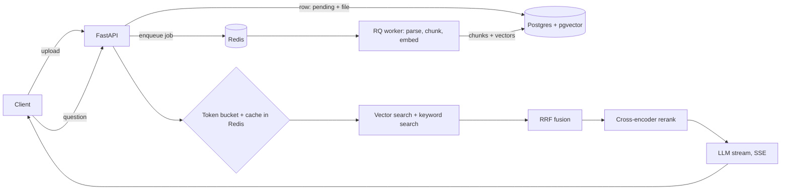

# RAG Service — multi-tenant document Q&A API

Upload documents, ask questions, get **streamed answers with citations**. Ingestion is asynchronous (Redis queue + workers),
retrieval is **hybrid** (Postgres full-text + pgvector, fused with RRF, reranked by a cross-encoder), and quality is
**measured** by an evaluation harness. Every part is tested, containerised and load-tested.



## Run it (Windows/Mac/Linux, needs Docker Desktop)
```bash
cp .env.example .env        # on Windows PowerShell: copy .env.example .env
# optional: put ANTHROPIC_API_KEY=... in .env  (without it, /query returns the top passages instead of a generated answer)
docker compose up --build   # first build downloads the embedding + reranker models (~2-3 min)
```
Open **http://localhost:8000/docs** (Swagger UI): `POST /auth/register` → click *Authorize* and paste the token →
`POST /documents` (pdf/txt/md/docx) → `GET /documents` until `status` is `ready` → `POST /query`.

| Endpoint | Purpose |
|---|---|
| `POST /auth/register`, `/auth/login` | JWT auth |
| `POST /documents` | upload (202 + async processing; same file twice returns the same document) |
| `GET /documents`, `GET /documents/{id}` | status: pending / processing / retrying / ready / failed |
| `POST /documents/{id}/retry`, `DELETE /documents/{id}` | retry a failed job / delete doc + chunks |
| `POST /query` | JSON answer. `mode`: vector, keyword, hybrid, hybrid_rerank. `generate:false` = retrieval only |
| `POST /query/stream` | Server-Sent Events: `sources` → `token`* → `done` |
| `GET /metrics` | p50/p95 latency per stage, cache hit rate, token usage, queue depth, dead-letter count |

## Tests, eval, load test
```bash
docker compose exec api pytest -q                                   # unit tests (integration tests: set RUN_INTEGRATION=1)
docker compose exec api python -m eval.eval --chunk-sizes 40 80 120 # sample handbook; use 200 350 500 on your own docs
docker compose exec api python -m eval.eval --chunk-sizes 200 350 --judge   # + LLM-as-judge faithfulness (needs API key)
docker compose exec api locust -f loadtest/locustfile.py --host http://localhost:8000 --headless -u 30 -r 5 -t 60s
```
**Evaluate on your own data:** put 3-10 documents in `eval/docs/`, and write 50+ entries in `eval/golden.json`
(`question` + a short `evidence` phrase that appears in the right passage). Relevance is judged by that phrase, so the same
golden set works for every chunk size.

## Results (fill in with YOUR measured numbers — never quote numbers you didn't measure)
| Setup | recall@5 | MRR | p95 latency |
|---|---|---|---|
| vector only | | | |
| keyword only | | | |
| hybrid (RRF) | | | |
| hybrid + rerank | | | |

Load test: ___ concurrent users, ___ req/s, p95 ___ ms (retrieval-only, 1 API container).

## Design decisions (and what I'd change at 100x scale)
- **Postgres + pgvector, not a separate vector DB:** one store gives transactions, tenant filtering, full-text and vectors
  together. At very large scale I'd move vectors to a dedicated engine or shard by tenant.
- **Queue for ingestion:** parsing/embedding takes seconds; the API returns 202 immediately. Jobs are *at-least-once*, so
  the worker is **idempotent** (it replaces a document's chunks in one transaction; uploads are de-duplicated by content hash).
  Retries back off at 10s/30s/90s; jobs that exhaust retries sit in RQ's failed registry (dead-letter) and the document shows `failed`.
- **Hybrid + RRF:** vectors capture meaning, keywords capture exact terms (codes, names). RRF merges ranks, so no score normalisation.
- **Cross-encoder rerank on a shortlist only:** accurate but slow, so it only sees the top ~20 candidates.
- **Tenant isolation:** every chunk row carries `user_id`, and every search filters on it. At scale: Postgres row-level security.
- **Token-bucket limiter in Redis (Lua script):** atomic across many API instances.
- **Cache key includes a corpus version:** uploading/deleting documents automatically invalidates stale answers.
- **SSE for streaming:** one-way, plain HTTP, simple; WebSockets add nothing here.
- **Fork-safe DB pool:** RQ forks per job, and sharing inherited sockets corrupts connections, so each child builds its own pool.
- **Known limitations:** word-count chunking approximates tokens; no OCR for scanned PDFs; one embedding model; the judge is an LLM, so it is noisy.
